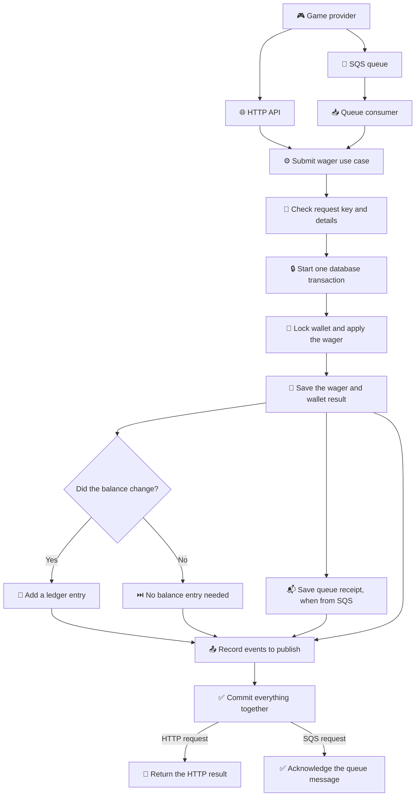
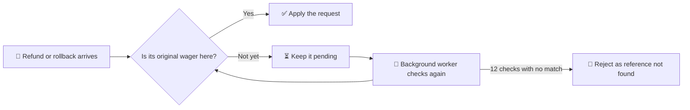
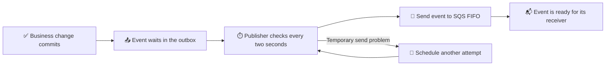
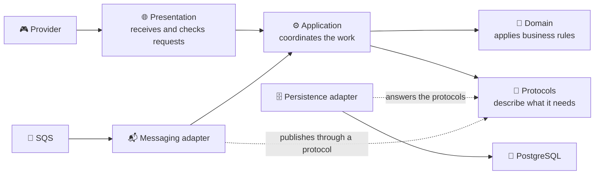

# 🐯 Fortune Tiger

Wager processor. Balance, ledger, and a repeated operation stay correct.

<p>
  <strong>CI / Coverage</strong><br />
  <a href="https://github.com/darkfrontcode/Fortune-Tiger/actions/workflows/ci.yml"></a>
  <a href="https://github.com/darkfrontcode/Fortune-Tiger/actions/workflows/security.yml"></a>
  
</p>

<hr />

<p>
  <strong>Infrastructure</strong><br />
  
  
  
  
  
  
  
  
  
  
  
</p>

<hr />

<p>
  <strong>Technology</strong><br />
  
  
  
  
</p>

A provider can send a bet, a win, a loss, a refund, or a rollback. Fortune Tiger keeps the wallet safe, remembers every balance change, and recognizes a repeated request.

<hr />

<details>
<summary>🎯 Domain — the money and wager rules</summary>

This is the game's rulebook:

- 💰 **Money** keeps amounts precise, so cents do not disappear in calculations.
- 👛 **Wallet** keeps the balance at zero or above.
- 📒 **Ledger** remembers each balance change and never edits history.
- 🎲 **Wager** tracks a bet from its arrival to its final result.

Think of it as a scorekeeper that never loses count.

</details>

<details>
<summary>⚙️ Application — turning requests into decisions</summary>

The application is the coordinator. It gives the same wager rules to requests from the HTTP API and the message queue.

- 🔁 Send the same request again with the same key, and it returns the original result instead of charging twice.
- 🧾 Reuse that key for different details, and the request is flagged as a conflict.
- 🔎 Missing references can be checked again later; reconciliation compares the wallet with its ledger without silently changing either.
- 👛 Every HTTP route delegates its operation to an explicit application use case; the global filter translates application errors into HTTP responses.
- 🧩 Ports and injection tokens live with their owning capability; cross-cutting observability and time contracts have explicit owners.

</details>

<details>
<summary>🗄️ Infrastructure — where data and messages live</summary>

The behind-the-scenes layer keeps the service dependable:

- 🐘 **PostgreSQL** stores wallets, wagers, and the ledger together.
- ⚡ **Redis** accelerates the wallet and wager reads with a cache-aside; it is an accelerator, never a source of truth, and a cache outage changes no financial answer.
- 🧾 **MongoDB** stores the append-only audit timeline, the per-caller journey, and the `searchable_events` read model. All are read models, never the source of a balance.
- 📬 **Inbox and outbox** help the service handle repeated messages and publish events after a successful save.
- ☁️ **LocalStack SQS** lets the queue run locally, including retries and dead-letter queues.
- 🔎 **Logs and metrics** help explain what happened without putting financial payloads in the logs.
- 📊 **Prometheus metrics** answer `GET /metrics`, so a scrape sees transactions by status, duplicates, retries, dead letters, lock conflicts, outbox lag, processing time, and the audit and journey counters.
- 📨 **Alertmanager** evaluates the Prometheus rules and emails `darkfrontcode@gmail.com` when the API is down, memory is high, or a metric signals trouble - dead letters, outbox lag, store failures, or a reconciliation divergence.

</details>

<details>
<summary>☸️ Kubernetes — the same app on three nodes</summary>

The cluster lives in [`kubernetes/`](kubernetes/) and starts with one command. It is a real kind cluster inside Docker, not a mock:

- 🖥️ three nodes: one control plane and two workers;
- 🐘 two PostgreSQL instances: a primary and a streaming standby (`pg_basebackup -R`);
- ⚙️ two API replicas behind one service, spread across the workers, with a disruption budget and a zero-downtime rollout;
- 📨 one LocalStack pod, with the queues created by the same script compose uses;
- ⚡ one Redis pod, shared by the API replicas for the wallet and wager read cache;
- 🧾 one migration Job, recreated on every apply, waited on before the run reports success;
- 📈 an optional Prometheus, Grafana, and Alertmanager overlay that scrapes each replica through the headless service and emails the operator when a rule fires.

Two replicas are safe because the guarantees already exist: the wallet row lock, `FOR UPDATE SKIP LOCKED` on the outbox, and the inbox row. A repeated bet still produces one debit, whichever pod answers.

```bash
bun run cluster:up
bun run cluster:verify
```

The topology, the failure drills, and the limits are in [`docs/kubernetes.md`](docs/kubernetes.md). The manifests are Kustomize: `overlays/local` for the cluster, `overlays/observability` for the dashboards and the alerting pair. The `CI` workflow raises this same cluster on a runner and runs `cluster:verify` after it, so the pull request is green on the real cluster, not on the manifest only.

</details>

<details>
<summary>🌐 Presentation — the front door</summary>

Providers use the HTTP API to open wallets, submit wagers, check results, browse a wallet's ledger, compare a wallet with its ledger, and read the audit timeline of one wager. Health checks answer a simpler question: “Is the service alive, and can it reach what it needs?”

The front door checks and translates requests. The money rules stay in the rulebook, not in the controller.

By default the caller is trusted through `X-Provider-Id`, which keeps the local setup simple. An optional `jwt` mode verifies a Keycloak token instead: start the `auth` compose profile, set `AUTH_MODE=jwt`, and send `Authorization: Bearer <token>`. The route rules are in [`docs/API.md`](docs/API.md#auth).

The whole contract is browsable while the service runs: `/docs` serves the Swagger UI, and `/docs-json` serves the same document as OpenAPI 3 JSON. Both stay open, and the document covers the provider routes only, so health and metrics stay out of it. The same document is checked in at [`docs/api/openapi.json`](docs/api/openapi.json); `bun run openapi:export` rewrites it, and the pipeline fails when the file and the code disagree.

</details>

<details>
<summary>🗺️ Flowcharts — follow a wager through the system</summary>

### One request, two ways in



The wallet, wager, ledger entry, queue receipt (when applicable), and outgoing events share the save. If the balance does not change — for example, for a loss — no balance entry is added.

### When a reference has not arrived yet



### Sending saved events



</details>

<details>
<summary>🧾 Audit store — the event timeline in MongoDB</summary>

Every integration event that leaves the financial transaction is also appended to an audit timeline in MongoDB. The financial truth stays in PostgreSQL; the audit store is a read model that answers “what happened to this wager, in order?”.

- 📤 The outbox publishes the same event to `wager-events.fifo`; a dedicated consumer maps the envelope and appends one document per `eventId`.
- 🔒 `eventId` is unique, so a redelivery is acknowledged as a duplicate instead of writing twice.
- 🔁 A temporary MongoDB failure returns the message to the queue; five receives send it to `wager-events-dlq.fifo`. An invalid event goes there immediately.
- 🚫 MongoDB is not part of `/health/ready`, and a wager is never rolled back because the audit write failed. The timeline is eventually consistent.
- 🔎 `GET /wagering/transactions/:transactionId/audit` returns the timeline for the caller provider, ordered by `occurredAt` and then `eventId`, with `eventType`, `from`, `to`, and `limit` filters.
- 🧱 Only `status`, `kind`, and `direction` enter the metadata; amounts, balances, and personal data stay out.

The application contract lives in [`src/application/audits/spec.md`](src/application/audits/spec.md), the adapter in [`src/infrastructure/audit/spec.md`](src/infrastructure/audit/spec.md), and the decision in [`docs/adr/0010-polyglot-audit-store-with-mongodb.md`](docs/adr/0010-polyglot-audit-store-with-mongodb.md).

</details>

<details>
<summary>🧭 Journey store — the per-caller view in MongoDB</summary>

The journey is what one request did, stage by stage: it entered the route, reached the use case, wrote the database or rolled back, and handed the event to the queue. It sits in MongoDB next to the audit timeline and never joins the financial SQL transaction.

- 🌐 `ROUTE` is recorded by the HTTP interceptor when the request enters; `USE_CASE`, `DATABASE`, and `QUEUE` are recorded by the use cases, the persistence writers, and the outbox publisher.
- ✅ Each settled stage carries `SUCCEEDED`, `FAILED`, or `ROLLBACK` and the time it spent, so a slow stage is visible.
- 🔒 `stepId` is unique, and `flowId` groups one aggregate; `providerId` + `playerId` join the steps of one caller across requests.
- 🚫 Recording is fire-and-forget. A MongoDB outage loses the observation of that step — never a balance, and never money.
- 👥 `GET /wagering/transactions/:transactionId/journey` reads the flow that produced a wager; `GET /providers/:providerId/players/:playerId/journey` reads a provider's own players. Both obey the caller's scope.
- 🧱 No amount, balance, token, or header ever enters a step.

The application contract lives in [`src/application/journeys/spec.md`](src/application/journeys/spec.md), the adapter in [`src/infrastructure/journey/spec.md`](src/infrastructure/journey/spec.md), and the decision in [`docs/adr/0011-journey-read-model-in-mongodb.md`](docs/adr/0011-journey-read-model-in-mongodb.md).

</details>

<details>
<summary>🔎 Semantic search — find similar events over MCP</summary>

An AI agent, through the Model Context Protocol, can ask for past events and failures similar to a description — for example, "a bet rejected because the balance ran out". Fortune Tiger exposes one stdio tool, `search_similar_events`, that answers with similar events from a semantic index. The financial truth stays in PostgreSQL and the timeline in `audit_events`; neither is touched.

- 🧾 A `searchable_events` collection on the atlas-local instance holds one non-financial summary per audit event, with an embedding. It is a read model seeded by `bun run search:seed`; the application never writes it at request time, and re-seeding never duplicates.
- 🗣️ `OllamaEmbedding` turns a query into a vector through `POST /api/embed`; `MongoVectorSearch` runs the `$vectorSearch` pipeline and projects only safe read fields — never an embedding, the summary text, a provider id, an amount, or a balance.
- 🧩 The capability lives in [`src/application/searches/spec.md`](src/application/searches/spec.md), the adapters in [`src/infrastructure/search/spec.md`](src/infrastructure/search/spec.md), the MCP wiring in [`src/infrastructure/mcp/spec.md`](src/infrastructure/mcp/spec.md), and the decision in [`docs/adr/0014-mcp-semantic-search-in-mongodb.md`](docs/adr/0014-mcp-semantic-search-in-mongodb.md).
- ⚙️ The pipeline runs it: `VECTOR_SEARCH_ENABLED=true` activates the search, the `search` compose profile runs the atlas-local instance and Ollama locally, and the CI workflow brings both up on every main and staging run — it pulls the Ollama embedding model, runs the seed, and proves a real search with `bun run search:check`. The application code never downloads a model itself.

</details>

<details>
<summary>🧭 Architecture — the ideas behind the code</summary>

Three ideas guide how this project is built:

- 📝 **Specification-Driven Development (SDD):** write down what a feature should do before building it; tests check that behavior.
- 🎲 **Domain-Driven Design (DDD):** organize the business around familiar concepts — money, wallet, ledger, and wager — and keep their rules together.
- 🧱 **Clean Architecture:** give each layer one job, and keep technical details such as databases and queues from deciding business rules.

### How the pieces fit



The domain is the rulebook. Application is the coordinator. Presentation is the front door. Infrastructure connects those parts to PostgreSQL, MongoDB, SQS, logs, and metrics. The application asks for capabilities through protocols; infrastructure supplies the technical adapters. Changing a database or queue should not rewrite the business rules.

Cross-layer imports use the `@application/*`, `@domain/*`, `@infrastructure/*`, and `@presentation/*` TypeScript aliases.

The reasoning behind the shape is in [`docs/adr/`](docs/adr/): fifteen short records, one per decision, each with the alternative that lost and the cost it carries.

</details>

<details>
<summary>🧪 Testing — prove the delivery</summary>

`bun run verify` lints, type-checks, and runs the unit suite; `bun run verify:full` adds PostgreSQL, MongoDB, LocalStack, migrations, integration, audit, concurrency, and end-to-end tests. Details in [docs/testing.md](docs/testing.md).

See the happy path in one command with `bun run demo`, and the reviewer's path in [docs/DELIVERY.md](docs/DELIVERY.md).

</details>

<details>
<summary>🔐 Security — the baseline that runs on every push</summary>

The security baseline lives in the repository and runs with the tools already here:

- 🧪 **API security suite** — `bun run test:security` sends hostile calls into the real `AppModule`: malformed money, insufficient funds, a concurrent double bet, a refund that points at the wrong kind, a reversal twice, a duplicate idempotency key, and a foreign provider reading someone else's audit or journey. It answers `400`, `409`, `422`, `404`, or one `PROCESSED` — the status table the API already promises.
- 🛡️ **OWASP ZAP** — `bun run security:zap` runs the passive scan from the live OpenAPI document (`GET /docs-json`) and writes the HTML report to `security/reports/passive`. `bun run security:zap --active` runs the active scan locally, never in the pipeline.
- 🎯 **AI red-team** — `bun run security:redteam` drives the real semantic search tool with crafted queries and asserts it never projects an amount, a balance, a provider id, a currency, or a secret.
- ⚙️ **One workflow** — `.github/workflows/security.yml` runs the suite and the passive scan on `main`, `staging`, and every pull request, with the same services as `CI`, and keeps the report as an artifact.

The security tests inherit the existing `*.e2e.test.ts` coverage ignore, so the 100% line gate is unchanged. Details are in [`security/spec.md`](security/spec.md) and [`docs/testing.md`](docs/testing.md).

</details>

<details>
<summary>🤖 AI co-builders — tools and models remembered so far</summary>

These are the coding assistants and model names used to build Fortune Tiger:

- 🖱️ **Cursor** — Composer 2.5 and Grok 4.7.
- 🧰 **OpenCode** — DeepSeek V4.1 Flash, Big Pickle & GLM-5.3 Flash.
- 🦆 **Clixad** — Gpt 5 Nano.
- 💻 **GitHub Copilot** — GPT-5.3 Codex.
- 🪐 **Antigravity** — Gemini 3.8 Flash High.
- 🖥️ **Devin Desktop** — SWE-1.6 Slow.
- 🧠 **OpenAI Codex** — GPT-5.6 Luna.
- 🧑‍💻 **Cline** — Laguna S 2.1 and Nemotron 3.5 Super VL.

</details>

<details>
<summary>🎨 Stack — the tools under the hood</summary>

- 🟠 **Bun** runs the app, installs packages, and runs tests.
- 🧱 **NestJS** organizes the HTTP service and its background workers.
- 🟦 **TypeScript** helps catch mistakes while building.
- 🐘 **PostgreSQL 16** keeps the financial records.
- ⚡ **Redis 7** backs the wallet and wager read cache.
- 🧾 **MongoDB 7** keeps the append-only audit timeline.
- 🧩 **MikroORM** connects the code to the database.
- 📚 **Mongoose** connects the audit adapter to MongoDB.
- 🔎 **mongodb-atlas-local** brings `mongot`, so `$vectorSearch` answers; the CI pipeline starts it on every main and staging run.
- 🗣️ **Ollama** produces embeddings; the seed and the MCP tool use it, and the CI pipeline starts it and pulls the model on every main and staging run.
- 🧩 **MCP SDK** exposes the single `search_similar_events` tool over stdio.
- 📨 **SQS on LocalStack** provides a queue that works on a developer's machine.
- 🐳 **Docker Compose** runs the local databases, queue, API, authentication, and observability profiles.
- ☸️ **Kubernetes on kind** runs the same image on three nodes, with two API replicas and two PostgreSQL instances, declared as Kustomize manifests.
- 📈 **Prometheus and Grafana** expose and visualize the application's metrics through the optional observability profile, and **Alertmanager** emails the operator when a rule fires.
- 🔐 **Keycloak** provides the optional JWT identity provider through the auth profile.
- 📘 **Swagger** publishes the HTTP contract at `/docs`.

</details>

<details>
<summary>🌿 History — how changes are shared</summary>

Work is grouped into a focused branch, one clear commit, and a pull request. In plain terms: make one small change, name it clearly, and ask for a review before it reaches `main`.

Branch names and commits follow the same pattern, such as `feat/docs/readme`. The allowed change types are `feat`, `fix`, `docs`, `refactor`, `test`, and `chore`.

</details>

<details>
<summary>🚀 Run — get the game running locally</summary>

### Start the app

```bash
bun install
cp .env.example .env
docker compose up -d
bun run migration:up
bun run start
```

The first three steps install the tools, prepare local settings, and start PostgreSQL, MongoDB, Redis, and LocalStack. The migration creates the database tables; the last command starts the service.

### Run everything in containers

```bash
docker compose --profile app up -d --build
```

The `app` profile builds the root `Dockerfile` once, applies the migrations in a one-shot `migrate` service, and starts the API with its workers on `3000`. `docker compose --profile app ps` shows `healthy` when `/health/live` answers, and `http://localhost:3000/health/ready` answers `ready` when PostgreSQL and SQS answer too. The containers keep the database and the queues from the manual setup, so the two ways share one stack; `docker compose down` stops everything.

### Run it on Kubernetes

```bash
bun run cluster:up
bun run cluster:verify
bun run cluster:observability
bun run cluster:status
bun run cluster:down
```

`cluster:up` builds the image, creates the kind cluster when it is absent, starts it again after a Docker restart, loads the image into the nodes, applies the manifests, waits for PostgreSQL, LocalStack, Mongo, Redis, the migration, and both API replicas, and checks `/health/ready`. The API answers on `http://127.0.0.1:30080`, Prometheus on `30090`, Grafana on `30030`, and Alertmanager on `30093`. It needs Docker only: `kind` and `kubectl` are reused from `PATH` or downloaded into `.tools/bin`, and on Windows Docker Desktop starts by itself. The versions and the troubleshooting are in [`docs/kubernetes.md`](docs/kubernetes.md).

`cluster:render` renders every overlay without a cluster, and the pipeline runs it, so a broken manifest fails before a cluster exists. `cluster:verify` proves the running shape — nodes, endpoints, replication, the migration, the financial flow with a replay, the Redis cache hit counter, and both replicas serving a burst — which is the second step of the `cluster` CI job on every push to `main` or `staging` and every pull request.

### Try the commands

```bash
bun run start:dev
bun run demo
bun run lint
bun run test:unit
bun run test:int
bun run test:audit
bun run test:journey
bun run test:concurrency
bun run test:e2e
bun run test:security
bun run security:zap
bun run test:load
```

`start:dev` restarts the app when files change. `demo` boots the app on a free port and walks the happy path — wallet, bet, replay, loss, ledger, reconciliation, metrics — asserting each result. `test:unit` checks the rules quickly. The integration and concurrency tests use the PostgreSQL and LocalStack services configured in `.env`; `test:audit` and `test:journey` use MongoDB and LocalStack. `test:e2e` runs HTTP endpoint tests with Supertest, and `test:security` runs the hostile-caller suite over the same app. `security:zap` scans a running API; start it with `bun run start` first. `test:load` measures the running API under concurrency; read [`docs/load.md`](docs/load.md) for the method, the results, and the honest limit.

### Try the API by hand

[`requests.http`](requests.http) carries the same steps plus the conflict, rejection, and not-found cases. The routes, headers, status table, and error bodies are in [docs/API.md](docs/API.md), and [docs/DELIVERY.md](docs/DELIVERY.md) is the reviewer's path through the delivery.

With the API running, `http://localhost:3000/docs` opens the same contract in the Swagger UI, read from the DTOs and the response decorators. `http://localhost:3000/docs-json` answers the OpenAPI 3 document itself.

### Prove it with one command

```bash
bun run verify
bun run verify:full
```

`verify` lints, type-checks the code, and runs the unit suite, so it needs nothing running. `bun run verify` lints, type-checks the code, and runs the unit suite, so it needs nothing running. `verify:full` checks that PostgreSQL, MongoDB, and LocalStack answer, then runs the migrations, the integration suite, the audit store suite, the journey store suite, the concurrency suite, and the end-to-end suite. The first failure stops the run, and the exit code is `1`.

### Pick a log style

Set `LOG_PRETTY=true` in `.env` for readable, one-line text output. Leave it unset or set it to `false` for JSON logs.

### Read the metrics

```bash
curl http://localhost:3000/metrics
```

The route answers the Prometheus text exposition: transactions by status, duplicates, retries, dead letters, lock conflicts, outbox lag, processing time, the audit and journey counters, and the cache hits and misses. `METRICS_BACKEND` chooses the adapter - `prometheus` by default, `memory` for the in-process counters without the Prometheus client.

A dashboard comes with the stack:

```bash
docker compose --profile app --profile observability up -d
```

Prometheus scrapes the API on `http://localhost:9090`, Grafana answers `http://localhost:3001` with the provisioned `Fortune Tiger` dashboard: transactions by status, replays, retries, dead letters, processing latency, outbox lag, and lock conflicts. Alertmanager answers `http://localhost:9093` and emails `darkfrontcode@gmail.com` when a rule in `docker/alerting` fires. Anonymous viewing is on in that profile; the panel queries read the same names the application publishes. Add a Gmail App Password to `docker/alerting/smtp-password` before relying on the email.

### Require a token (optional)

```bash
docker compose --profile auth up -d
```

The `auth` profile starts Keycloak with the demo realm. Set `AUTH_MODE=jwt` and the `OIDC_*` values from `.env.example`, restart the API, and send `Authorization: Bearer <token>`. The default `anonymous` mode needs none of this, and the queue keeps receiving its provider identity from the message.

The mode is smoke-tested end to end, against that realm, in one command:

```bash
bun run auth:smoke
```

It asks Keycloak for a token, boots the API in `jwt` mode, and asserts the refusals and the identity: `401` without a token, a wallet still open with `201`, a bet accepted with the token, the provider read from the token even when the header and the body name another one, `404` under that other provider, and `401` for a forged token.

### Search for similar events

The semantic search uses Ollama (the default embedding provider) and the `atlas-local` vector engine, two containers plus a model. Start them, then enable the feature. The seed and the MCP server do not need the HTTP API, and locally they need the stack up:

```bash
docker compose --profile search up -d
# pull an embedding model, for example:
docker exec -it fortune-tiger-ollama ollama pull embeddinggemma
```

Set `VECTOR_SEARCH_ENABLED=true` and the `SEARCH_*` values from `.env.example`. Seed the read model from the existing audit timeline, prove the search answers, then serve queries through a stdio MCP server:

```bash
bun run search:seed
bun run search:check
bun run mcp
```

`search:seed` reads `audit_events`, embeds a non-financial summary per event through Ollama, upserts `searchable_events` (keyed on the source `eventId`, so re-seeding never duplicates), and creates the vector index when it is missing. `search:check` runs a real query against the seeded index and exits `0` when the search answers. `mcp` connects an `McpServer` to a `StdioServerTransport` and exposes the single `search_similar_events` tool. The scripts refuse to start when `VECTOR_SEARCH_ENABLED` is false. The CI pipeline for main and staging starts the search stack, pulls the model, seeds, and exercises a real search on every run; a plain local `bun run verify` does not require the extra containers.

</details>

## Screenshots

The on-call engineer. The ledger stayed calm. He did not.


