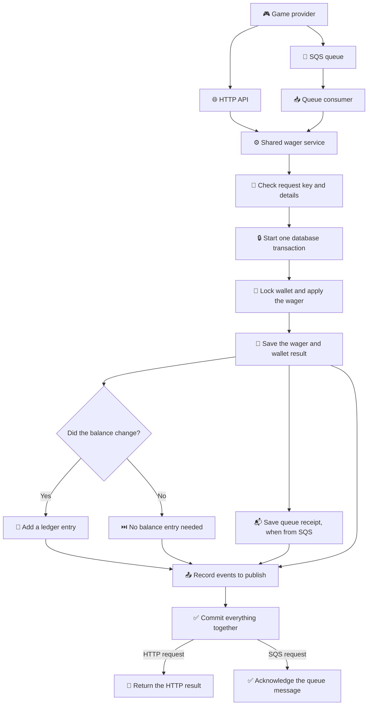
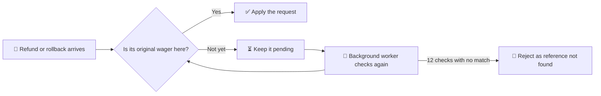
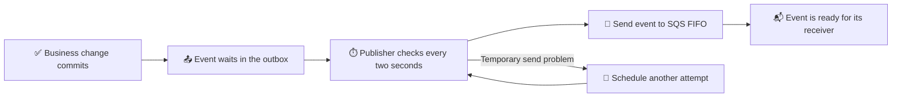
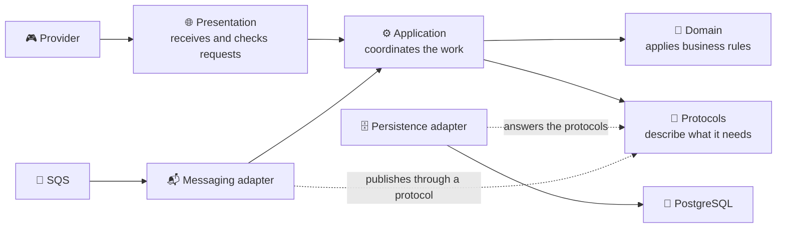

# 🐯 Fortune Tiger

Wager processor. Balance, ledger, and a repeated operation stay correct.

<p>
  
  
  
  
  
  
</p>

A provider can send a bet, a win, a loss, a refund, or a rollback. Fortune Tiger keeps the wallet safe, remembers every balance change, and recognizes a repeated request.

<details>
<summary>🎯 Domain — the money and wager rules</summary>

This is the game's rulebook:

- 💰 **Money** keeps amounts precise, so cents do not disappear in calculations.
- 👛 **Wallet** keeps the balance at zero or above.
- 📒 **Ledger** remembers each balance change and never edits history.
- 🎲 **Wager** tracks a bet from its arrival to its final result.

Think of it as a scorekeeper that never loses count.

</details>

<details>
<summary>⚙️ Application — turning requests into decisions</summary>

The application is the coordinator. It gives the same wager rules to requests from the HTTP API and the message queue.

- 🔁 Send the same request again with the same key, and it returns the original result instead of charging twice.
- 🧾 Reuse that key for different details, and the request is flagged as a conflict.
- 🔎 Missing references can be checked again later; reconciliation compares the wallet with its ledger without silently changing either.

</details>

<details>
<summary>🗄️ Infrastructure — where data and messages live</summary>

The behind-the-scenes layer keeps the service dependable:

- 🐘 **PostgreSQL** stores wallets, wagers, and the ledger together.
- 📬 **Inbox and outbox** help the service handle repeated messages and publish events after a successful save.
- ☁️ **LocalStack SQS** lets the queue run locally, including retries and a dead-letter queue.
- 🔎 **Logs and metrics** help explain what happened without putting financial payloads in the logs.

</details>

<details>
<summary>🌐 Presentation — the front door</summary>

Providers use the HTTP API to open wallets, submit wagers, check results, browse a wallet's ledger, and compare a wallet with its ledger. Health checks answer a simpler question: “Is the service alive, and can it reach what it needs?”

The front door checks and translates requests. The money rules stay in the rulebook, not in the controller.

</details>

<details>
<summary>🗺️ Flowcharts — follow a wager through the system</summary>

### One request, two ways in



The wallet, wager, ledger entry, queue receipt (when applicable), and outgoing events share the save. If the balance does not change — for example, for a loss — no balance entry is added.

### When a reference has not arrived yet



### Sending saved events



</details>

<details>
<summary>🧭 Architecture — the ideas behind the code</summary>

Three ideas guide how this project is built:

- 📝 **Specification-Driven Development (SDD):** write down what a feature should do before building it; tests check that behavior.
- 🎲 **Domain-Driven Design (DDD):** organize the business around familiar concepts — money, wallet, ledger, and wager — and keep their rules together.
- 🧱 **Clean Architecture:** give each layer one job, and keep technical details such as databases and queues from deciding business rules.

### How the pieces fit



The domain is the rulebook. Application is the coordinator. Presentation is the front door. Infrastructure connects those parts to PostgreSQL, SQS, logs, and metrics. The application asks for capabilities through protocols; infrastructure supplies the technical adapters. Changing a database or queue should not rewrite the business rules.

</details>

<details>
<summary>🤖 AI co-builders — tools and models remembered so far</summary>

These are the coding assistants and model names used to build Fortune Tiger:

- 🖱️ **Cursor** — Composer 2.5 and Grok 4.7.
- 🧰 **OpenCode** — DeepSeek V4.1 Flash.
- 🦆 **CLIXAD** (terminal assistant) — DeepSeek V4.1 Flash.
- 💻 **GitHub Copilot in VS Code** — GPT-5.3-Codex.

</details>

<details>
<summary>🎨 Stack — the tools under the hood</summary>

- 🟠 **Bun** runs the app, installs packages, and runs tests.
- 🧱 **NestJS** organizes the HTTP service and its background workers.
- 🟦 **TypeScript** helps catch mistakes while building.
- 🐘 **PostgreSQL 16** keeps the financial records.
- 🧩 **MikroORM** connects the code to the database.
- 📨 **SQS on LocalStack** provides a queue that works on a developer's machine.

</details>

<details>
<summary>🌿 History — how changes are shared</summary>

Work is grouped into a focused branch, one clear commit, and a pull request. In plain terms: make one small change, name it clearly, and ask for a review before it reaches `main`.

Branch names and commits follow the same pattern, such as `feat/docs/readme`. The allowed change types are `feat`, `fix`, `docs`, `refactor`, `test`, and `chore`.

</details>

<details>
<summary>🚀 Run — get the game running locally</summary>

### Start the app

```bash
bun install
cp .env.example .env
docker compose up -d
bun run migration:up
bun run start
```

The first three steps install the tools, prepare local settings, and start PostgreSQL and LocalStack. The migration creates the database tables; the last command starts the service.

### Try the commands

```bash
bun run start:dev
bun run test:unit
bun run test:int
bun run test:concurrency
```

`start:dev` restarts the app when files change. `test:unit` checks the rules quickly. The integration and concurrency tests use the PostgreSQL and LocalStack services configured in `.env`.

### Pick a log style

Set `LOG_PRETTY=true` in `.env` for readable, one-line text output. Leave it unset or set it to `false` for JSON logs.

</details>

## Screenshots

The on-call engineer. The ledger stayed calm. He did not.


