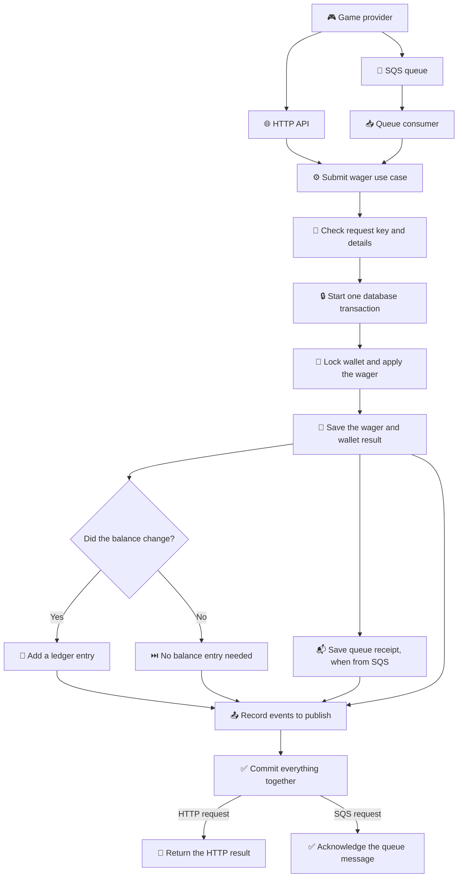
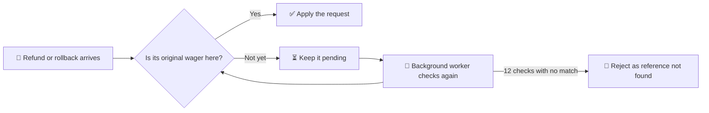
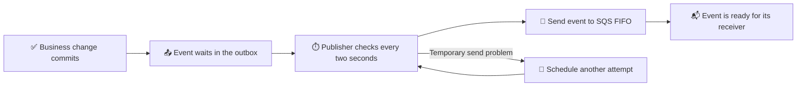
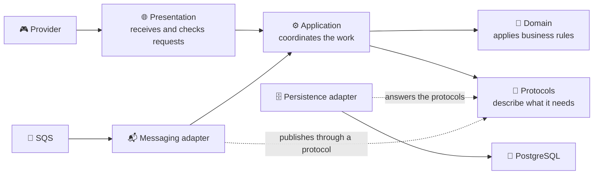

# 🐯 Fortune Tiger

Wager processor. Balance, ledger, and a repeated operation stay correct.

<p>
  
  
  
  
  
  
  
</p>

A provider can send a bet, a win, a loss, a refund, or a rollback. Fortune Tiger keeps the wallet safe, remembers every balance change, and recognizes a repeated request.

Prove the delivery with one command: `bun run verify` lints, type-checks, and runs the unit suite; `bun run verify:full` adds PostgreSQL, LocalStack, migrations, integration, concurrency, and end-to-end tests. Details in [docs/testing.md](docs/testing.md). See the happy path in one command with `bun run demo`, and the reviewer's path in [docs/DELIVERY.md](docs/DELIVERY.md).

<details>
<summary>🎯 Domain — the money and wager rules</summary>

This is the game's rulebook:

- 💰 **Money** keeps amounts precise, so cents do not disappear in calculations.
- 👛 **Wallet** keeps the balance at zero or above.
- 📒 **Ledger** remembers each balance change and never edits history.
- 🎲 **Wager** tracks a bet from its arrival to its final result.

Think of it as a scorekeeper that never loses count.

</details>

<details>
<summary>⚙️ Application — turning requests into decisions</summary>

The application is the coordinator. It gives the same wager rules to requests from the HTTP API and the message queue.

- 🔁 Send the same request again with the same key, and it returns the original result instead of charging twice.
- 🧾 Reuse that key for different details, and the request is flagged as a conflict.
- 🔎 Missing references can be checked again later; reconciliation compares the wallet with its ledger without silently changing either.
- 👛 Every HTTP route delegates its operation to an explicit application use case; the global filter translates application errors into HTTP responses.
- 🧩 Ports and injection tokens live with their owning capability; cross-cutting observability and time contracts have explicit owners.

</details>

<details>
<summary>🗄️ Infrastructure — where data and messages live</summary>

The behind-the-scenes layer keeps the service dependable:

- 🐘 **PostgreSQL** stores wallets, wagers, and the ledger together.
- 📬 **Inbox and outbox** help the service handle repeated messages and publish events after a successful save.
- ☁️ **LocalStack SQS** lets the queue run locally, including retries and a dead-letter queue.
- 🔎 **Logs and metrics** help explain what happened without putting financial payloads in the logs.
- 📊 **Prometheus metrics** answer `GET /metrics`, so a scrape sees transactions by status, duplicates, retries, dead letters, lock conflicts, outbox lag, and processing time.

</details>

<details>
<summary>🌐 Presentation — the front door</summary>

Providers use the HTTP API to open wallets, submit wagers, check results, browse a wallet's ledger, and compare a wallet with its ledger. Health checks answer a simpler question: “Is the service alive, and can it reach what it needs?”

The front door checks and translates requests. The money rules stay in the rulebook, not in the controller.

By default the caller is trusted through `X-Provider-Id`, which keeps the local setup simple. An optional `jwt` mode verifies a Keycloak token instead: start the `auth` compose profile, set `AUTH_MODE=jwt`, and send `Authorization: Bearer <token>`. The route rules are in [`docs/API.md`](docs/API.md#auth).

The whole contract is browsable while the service runs: `/docs` serves the Swagger UI, and `/docs-json` serves the same document as OpenAPI 3 JSON. Both stay open, and the document covers the provider routes only, so health and metrics stay out of it. The same document is checked in at [`docs/api/openapi.json`](docs/api/openapi.json); `bun run openapi:export` rewrites it, and the pipeline fails when the file and the code disagree.

</details>

<details>
<summary>🗺️ Flowcharts — follow a wager through the system</summary>

### One request, two ways in



The wallet, wager, ledger entry, queue receipt (when applicable), and outgoing events share the save. If the balance does not change — for example, for a loss — no balance entry is added.

### When a reference has not arrived yet



### Sending saved events



</details>

<details>
<summary>🧭 Architecture — the ideas behind the code</summary>

Three ideas guide how this project is built:

- 📝 **Specification-Driven Development (SDD):** write down what a feature should do before building it; tests check that behavior.
- 🎲 **Domain-Driven Design (DDD):** organize the business around familiar concepts — money, wallet, ledger, and wager — and keep their rules together.
- 🧱 **Clean Architecture:** give each layer one job, and keep technical details such as databases and queues from deciding business rules.

### How the pieces fit



The domain is the rulebook. Application is the coordinator. Presentation is the front door. Infrastructure connects those parts to PostgreSQL, SQS, logs, and metrics. The application asks for capabilities through protocols; infrastructure supplies the technical adapters. Changing a database or queue should not rewrite the business rules.

Cross-layer imports use the `@application/*`, `@domain/*`, `@infrastructure/*`, and `@presentation/*` TypeScript aliases.

The reasoning behind the shape is in [`docs/adr/`](docs/adr/): nine short records, one per decision, each with the alternative that lost and the cost it carries.

</details>

<details>
<summary>🤖 AI co-builders — tools and models remembered so far</summary>

These are the coding assistants and model names used to build Fortune Tiger:

- 🖱️ **Cursor** — Composer 2.5 and Grok 4.7.
- 🧰 **OpenCode** — DeepSeek V4.1 Flash, Big Pickle & GLM-5.3 Flash.
- 🦆 **Clixad** — GPT-05 reasoning.
- 💻 **GitHub Copilot** — GPT-5.3-Codex.
- 🪐 **Antigravity** — Gemini 3.8 Flash High.
- 🖥️ **Devin Desktop** — SWE-1.6 Slow.

</details>

<details>
<summary>🎨 Stack — the tools under the hood</summary>

- 🟠 **Bun** runs the app, installs packages, and runs tests.
- 🧱 **NestJS** organizes the HTTP service and its background workers.
- 🟦 **TypeScript** helps catch mistakes while building.
- 🐘 **PostgreSQL 16** keeps the financial records.
- 🧩 **MikroORM** connects the code to the database.
- 📨 **SQS on LocalStack** provides a queue that works on a developer's machine.
- 📘 **Swagger** publishes the HTTP contract at `/docs`.

</details>

<details>
<summary>🌿 History — how changes are shared</summary>

Work is grouped into a focused branch, one clear commit, and a pull request. In plain terms: make one small change, name it clearly, and ask for a review before it reaches `main`.

Branch names and commits follow the same pattern, such as `feat/docs/readme`. The allowed change types are `feat`, `fix`, `docs`, `refactor`, `test`, and `chore`.

</details>

<details>
<summary>🚀 Run — get the game running locally</summary>

### Start the app

```bash
bun install
cp .env.example .env
docker compose up -d
bun run migration:up
bun run start
```

The first three steps install the tools, prepare local settings, and start PostgreSQL and LocalStack. The migration creates the database tables; the last command starts the service.

### Run everything in containers

```bash
docker compose --profile app up -d --build
```

The `app` profile builds the root `Dockerfile` once, applies the migrations in a one-shot `migrate` service, and starts the API with its workers on `3000`. `docker compose --profile app ps` shows `healthy` when `/health/live` answers, and `http://localhost:3000/health/ready` answers `ready` when PostgreSQL and SQS answer too. The containers keep the database and the queues from the manual setup, so the two ways share one stack; `docker compose down` stops everything.

### Try the commands

```bash
bun run start:dev
bun run demo
bun run lint
bun run test:unit
bun run test:int
bun run test:concurrency
bun run test:e2e
bun run test:load
```

`start:dev` restarts the app when files change. `demo` boots the app on a free port and walks the happy path — wallet, bet, replay, loss, ledger, reconciliation, metrics — asserting each result. `test:unit` checks the rules quickly. The integration and concurrency tests use the PostgreSQL and LocalStack services configured in `.env`. `test:e2e` runs HTTP endpoint tests with Supertest. `test:load` measures the running API under concurrency; start it with `bun run start` first, and read [`docs/load.md`](docs/load.md) for the method, the results, and the honest limit.

### Try the API by hand

[`requests.http`](requests.http) carries the same steps plus the conflict, rejection, and not-found cases. The routes, headers, status table, and error bodies are in [docs/API.md](docs/API.md), and [docs/DELIVERY.md](docs/DELIVERY.md) is the reviewer's path through the delivery.

With the API running, `http://localhost:3000/docs` opens the same contract in the Swagger UI, read from the DTOs and the response decorators. `http://localhost:3000/docs-json` answers the OpenAPI 3 document itself.

### Prove it with one command

```bash
bun run verify
bun run verify:full
```

`verify` lints, type-checks the code, and runs the unit suite, so it needs nothing running. `verify:full` checks that PostgreSQL and LocalStack answer, then runs the migrations, the integration suite, the concurrency suite, and the end-to-end suite. The first failure stops the run, and the exit code is `1`.

### Pick a log style

Set `LOG_PRETTY=true` in `.env` for readable, one-line text output. Leave it unset or set it to `false` for JSON logs.

### Read the metrics

```bash
curl http://localhost:3000/metrics
```

The route answers the Prometheus text exposition: transactions by status, duplicates, retries, dead letters, lock conflicts, outbox lag, and processing time. `METRICS_BACKEND` chooses the adapter - `prometheus` by default, `memory` for the in-process counters without the Prometheus client.

A dashboard comes with the stack:

```bash
docker compose --profile app --profile observability up -d
```

Prometheus scrapes the API on `http://localhost:9090`, and Grafana answers `http://localhost:3001` with the provisioned `Fortune Tiger` dashboard: transactions by status, replays, retries, dead letters, processing latency, outbox lag, and lock conflicts. Anonymous viewing is on in that profile; the panel queries read the same names the application publishes.

### Require a token (optional)

```bash
docker compose --profile auth up -d
```

The `auth` profile starts Keycloak with the demo realm. Set `AUTH_MODE=jwt` and the `OIDC_*` values from `.env.example`, restart the API, and send `Authorization: Bearer <token>`. The default `anonymous` mode needs none of this, and the queue keeps receiving its provider identity from the message.

The mode is smoke-tested end to end, against that realm, in one command:

```bash
bun run auth:smoke
```

It asks Keycloak for a token, boots the API in `jwt` mode, and asserts the refusals and the identity: `401` without a token, a wallet still open with `201`, a bet accepted with the token, the provider read from the token even when the header and the body name another one, `404` under that other provider, and `401` for a forged token.

</details>

## Screenshots

The on-call engineer. The ledger stayed calm. He did not.


