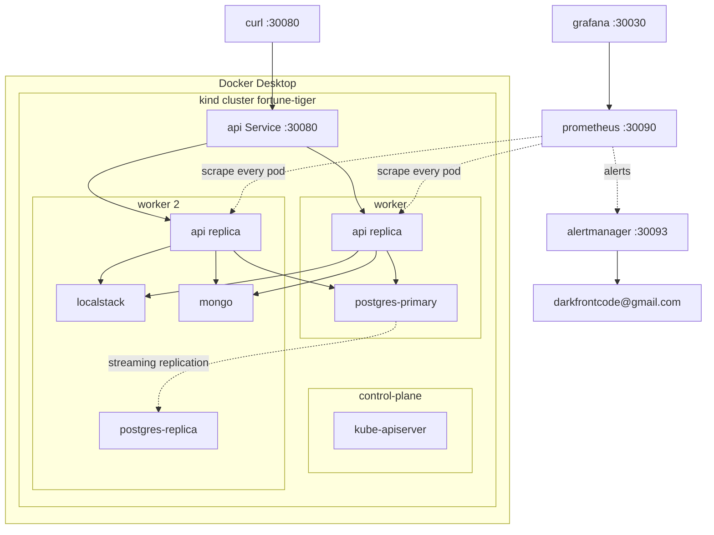

# Kubernetes

A three-node Kubernetes cluster running inside Docker, with the whole application on it. Use it when the question is not "does the rule work" but "does it keep working when the rule runs on several machines at once".

The manifests live in [`kubernetes/`](../kubernetes/), and the folder spec describes every object. This page is the operator's path: start it, read it, break it, and know what it does not cover.

## Topology



The control plane is tainted, so it runs no workload: the two API replicas and the two database instances split across the two workers, and the scheduler is free to place `localstack` and `mongo` on either. The picture is one healthy arrangement.

## Shape

| Workload | Pods | Why that number |
| --- | --- | --- |
| `api` | 2 | two processes behind one address, spread across nodes; each runs the HTTP API, the outbox publisher, the reference worker, and the queue consumer |
| `postgres-primary` | 1 | the only writer |
| `postgres-replica` | 1 | streaming standby, scheduled on the node without a database pod |
| `localstack` | 1 | it is the broker; two replicas would be two queue sets, and a message published to one would never be consumed from the other |
| `mongo` | 1 | the read models live here; the audit timeline and the journey store are not financial state, so the API keeps working while it is down |
| `migrate` | 1 | a Job that completes and stays as evidence |

The API scales horizontally: `kubectl -n fortune-tiger scale deploy/api --replicas=3` adds a third endpoint, and the spread keeps the pods balanced across both workers. The database pair and the broker stay as they are, for the reasons above.

## Load balancing

The `api` Service is the load balancer. Both replicas register in its endpoints, and kube-proxy spreads connections across them:

```bash
kubectl -n fortune-tiger get endpoints api
```

lists the two addresses. The balance is at layer 4, per connection: a client that keeps one keep-alive connection open stays on one pod, and separate connections alternate. A loop of `curl` calls, a browser opening several connections, and the load script all spread across the pods; a single pooled HTTP client may pin to one, which is the expected behavior of a TCP load balancer, not a missing configuration.

Each pod serves its own `/metrics`, so the split is visible in `wager_transactions_processed_total` on the two pods after a burst of independent requests.

## Prerequisites

| Tool | Version | Install |
| --- | --- | --- |
| Docker | any recent Desktop or Engine | the only manual install; on Windows the script starts Docker Desktop when it is not running |
| Bun | 1.x | already needed by the repository |

`kind` and `kubectl` are not on that list on purpose. The script looks for them on `PATH` and reuses the ones it finds; when one is missing, it downloads the pinned release into `.tools/bin` and uses it from there. `.tools` is ignored by git, so a fresh clone needs nothing but Docker and Bun.

The cluster image is pinned to `kindest/node:v1.32.0`. Docker has to be able to give the cluster about 2 GB; the sum of the requests is under 1 GB, and the images are the same ones compose already pulls.

## Start it

```bash
bun run cluster:up
```

The command does eight things:

1. checks `docker`, `kind`, and `kubectl`, downloading the last two when they are missing, and starts Docker Desktop on Windows when the engine is not answering;
2. creates the cluster when it is absent, and reuses it when it is not, starting its containers again after a Docker restart;
3. waits for the cluster API and for all three nodes to be `Ready`;
4. builds `fortune-tiger:local` from the root `Dockerfile`;
5. loads the image into the three nodes, so no registry is needed;
6. applies `kubernetes/overlays/local`;
7. waits for both database instances, the queue, and Mongo, runs the migration Job, and waits for both API replicas;
8. calls `GET /health/ready` through the node port and fails the run when it does not answer `ready`.

The first run pulls `postgres:16`, `localstack/localstack:3`, `mongo:7`, and the node image; with those layers cached it finished in under seven minutes on a laptop, and a machine that has to download them takes longer. Later runs reuse everything, rebuild only what changed, and finish in about a minute. Running it twice in a row is safe: the cluster, the volumes, and the data stay.

## Read it

| Address | What answers |
| --- | --- |
| `http://127.0.0.1:30080/health/ready` | the load balancer in front of both replicas |
| `http://127.0.0.1:30080/docs` | Swagger UI |
| `http://127.0.0.1:30080/metrics` | the exposition of the pod that served the request |
| `http://127.0.0.1:30090` | Prometheus, after `bun run cluster:observability` |
| `http://127.0.0.1:30030` | Grafana, anonymous viewer |
| `http://127.0.0.1:30093` | Alertmanager |

```bash
bun run cluster:status
```

prints the nodes, the pods with their node, the services, the endpoints, and the readiness body.

The same happy path as `requests.http` works against `30080`. A bet is served by one of the two replicas, and the second one sees the committed row on its next request, because the state lives in PostgreSQL, not in the process.

## Break it

The cluster is there to be broken. Each drill is one command and one expectation.

| Drill | Command | Expected |
| --- | --- | --- |
| kill a replica | `kubectl -n fortune-tiger delete pod <one api pod>` | `/health/ready` stays `200`, the Deployment starts a replacement, the PDB keeps one pod serving |
| scale the API | `kubectl -n fortune-tiger scale deploy/api --replicas=3` | a third pod becomes ready on the free node and `kubectl get endpoints api` lists three addresses |
| kill the standby | `kubectl -n fortune-tiger delete pod postgres-replica-0` | the pod returns `1/1` and `pg_stat_replication` shows `streaming` again |
| drain a node | `kubectl drain fortune-tiger-worker --ignore-daemonsets --delete-emptydir-data` | the PDB moves one API pod at a time, and the service keeps answering |
| stop the queue | `kubectl -n fortune-tiger scale deploy/localstack --replicas=0` | readiness turns `503` and the pods leave the endpoints, while liveness stays `200` |
| stop the datalake | `kubectl -n fortune-tiger scale deploy/mongo --replicas=0` | the API keeps serving `200` because readiness ignores Mongo; a later `bun run cluster:verify` fails its datalake check until the store is back |
| read the standby | `kubectl -n fortune-tiger exec postgres-replica-0 -- psql -U postgres -d fortune_tiger -c 'select count(*) from wallets'` | the same count as the primary, a moment later |

The last one shows the replication lag honestly: the standby trails the primary by the time a WAL segment takes to arrive, which is why the API does not read from it.

## Observability

```bash
bun run cluster:observability
```

applies the `observability` overlay on top of the local one: Prometheus on `30090`, Grafana on `30030`, Alertmanager on `30093`, and the ConfigMaps generated from `docker/alerting` and `docker/grafana`. Prometheus discovers the API pods through the headless service, so a scrape covers both replicas instead of one address the service happened to pick.

`http://127.0.0.1:30090/api/v1/targets` lists one target per replica, both `up`. `http://127.0.0.1:30090/alerts` shows the alert rules from `docker/alerting/rules`, and `http://127.0.0.1:30093` is the Alertmanager UI, whose `email` receiver is addressed to `darkfrontcode@gmail.com`. Before relying on email delivery, put a real Gmail App Password in the `alertmanager-smtp` Secret (see `kubernetes/overlays/observability/alertmanager/alertmanager.smtp.secret.yaml`).

## Images

`cluster:up` builds and loads `fortune-tiger:local`. After a change:

```bash
bun run cluster:up
```

rebuilds the image, loads it again, and rolls the Deployment with `maxUnavailable: 0`, so a new pod becomes ready before an old one leaves. The migration Job is deleted and recreated on every run.

## Commands

| Command | Purpose |
| --- | --- |
| `bun run cluster:up` | build, create, load, apply, migrate, wait |
| `bun run cluster:observability` | add Prometheus, Grafana, and Alertmanager |
| `bun run cluster:status` | nodes, pods, services, endpoints, readiness |
| `bun run cluster:verify` | prove the shape: nodes, endpoints, replication, migration, the financial flow, the datalake collections, and both replicas serving |
| `bun run cluster:render` | render every overlay, no cluster needed |
| `bun run cluster:down` | delete the cluster and its volumes |

## Continuous integration

The `CI` workflow in `.github/workflows/ci.yml` carries a `cluster` job that runs on `ubuntu-latest`: it installs Bun, runs `bun run cluster:up` to raise the real cluster from the manifests, and finishes with `bun run cluster:verify`. The job installs nothing else — the runner already has Docker, and the script downloads `kind` and `kubectl` into `.tools/bin` there just as it does on a workstation. A failing run prints the nodes, the pods, and the last events, and the job stays red.

That is the same two commands that start and check the cluster locally, so what is green in the pull request is the same shape that runs here. The `test` job covers the suites against Docker services; the `cluster` job covers the manifests against a real cluster, and the two run in parallel.

## Limits

- Three nodes on one machine: shared kernel, shared disk, no real network partition.
- No ingress, no TLS, no cert-manager. The API is a node port.
- No automatic failover. The standby is a recovery target, and promoting it is manual.
- `anonymous` auth. The `jwt` mode needs Keycloak, which has no manifest here.
- The database and queue are single-writer by design. Two PostgreSQL instances are one primary and one standby, not a sharded pair.
- Mongo is one instance, not a replica set: it holds the audit timeline and the journey store, observations the financial path never reads.
- The secrets are demo values inside the repository.

## Troubleshooting

- `failed to init node with kubeadm` on an older Docker/WSL pair: the newest node image needs cgroup v2. The pinned `v1.32.0` image avoids that, so keep the pin.
- `Docker did not answer in time`: the engine did not come back on its own. Start Docker Desktop, wait for the whale to settle, and run `bun run cluster:up` again. The cluster and its data come back with it.
- `ImagePullBackOff` for `fortune-tiger:local`: the image was not loaded. Run `cluster:up` again; it loads the image before applying.
- The API answers `503` right after `up`: readiness waits for PostgreSQL and SQS. Run `bun run cluster:status` and read the pod that is not ready.
- `kubectl apply -k` refuses the tree with a `security; file is not in or below` error: the LocalStack bootstrap is mounted from `docker/localstack`, which sits above the kustomization root. The script renders with `kubectl kustomize --load-restrictor LoadRestrictionsNone` and pipes the result, so use `bun run cluster:up` instead of a bare `kubectl apply -k`.
